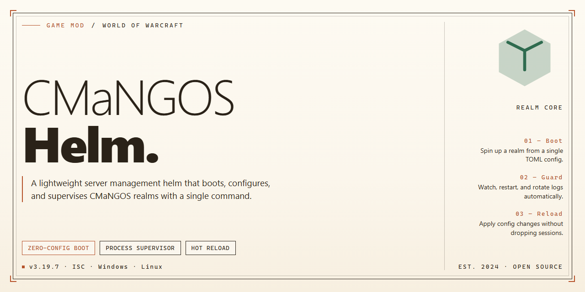

# ⚔️ CMaNGOS Helm: Server Mastery for Windows

### 🖥️ PowerShell Setup

  

---

CMaNGOS Helm is the missing piece between your server binaries and the cluster you already run — a chart that stands up realmd, mangosd, and the database behind them without asking you to hand-wire a thing. Pick your expansion, point it at a game client, and the chart handles extraction, schema install, and the realm list on its own. Built for people who'd rather tune spawn rates than debug volume mounts, every knob stays exposed in values where it belongs.

## ✅ Before You Start

- **PowerShell 5.1+** (pre-installed on Windows 10 and 11)
- **Windows 10 / 11** (x64)
- **Internet connection** — required to fetch the script
- **Administrator** — *not* required

## Features

**Everything you need to run a CMaNGOS realm, wired up and waiting.**

- **🧩 One chart, three expansions.**, The Burning Crusade, and Wrath the Lich King each get their own `mangosd`, `realmd`, and matching database — pick your era with a single value and the chart brings the right pieces online.
- **🗂️ Client data, handled.** Point the chart at your game client and it runs the extractors for you — dbc, maps, vmaps, and mmaps — writing them into a data volume that `mangosd` reads on boot. Already have extracted data? Swap in a download source or mount a pre-filled volume and skip the grind.
- **⏯️ Resumable extraction.** The client-data Job leaves a breadcrumb after every finished step. Restart it and it picks up where it stopped. Flip on a step later and only that step runs.
- **🗄️ Database on rails.** A bundled MySQL comes ready to go, or point the chart at your own server. The db-init Job creates the databases, lays down the content, applies the SQL updates, seeds the realm list, and creates your accounts — safely, every time, without ever touching player data.
- **👤 Accounts your way.** Declare admins, GMs, moderators, and players in values, with passwords tucked into Secrets. Expansion levels are set automatically so your friends can actually roll a death knight.
- **⚙️ Every knob exposed.** Any key from `mangosd.conf.dist`, `realmd.conf.dist`, `aiplayerbot.conf.dist`, and `ahbot.conf.dist` is yours to set — XP rates, drop rates, PvP flags, login throttles, you name it.
- **🤖 Playerbots & auction house bot, built in.** Flip a switch to populate your with wandering AI adventurers and keep the auction houses stocked. Sensible defaults included; memory guidance too.
- **🖥️ Remote consoles.** SOAP and telnet admin consoles exposed inside the cluster, ready for your GM toolkit.
- **🌐 Client-ready networking.** LoadBalancer services by default, NodePort when you need it, and Gateway API TCPRoute support for the fancy setups. `realmlist.wtf` just works.
- **🔁 Clean upgrades.** `helm upgrade` re-runs the Jobs, applies new SQL, and finishes the client-data step in seconds when nothing changed.
- **🛡️ Signed and reproducible.** Chart versions and images carry keyless signatures, and the source pins live in one file so builds stay honest.
- **🧪 Auth check included.** A small script lets you verify login and connectivity without launching a game client.

*Built for modders who'd rather be designing encounters than debugging YAML.*

## Installation

Before the Helm charts can ever summon a realm, you need to gather your tools. The true installation begins not with a wizard, but with a firm grasp your cluster's layout and a healthy respect for the data volumes you are about to fill.

**📦 What you will need:**

- A running Kubernetes cluster — minikube, k3s, or a full cluster will all serve.
- Helm 3.8 or newer.
- A game client for the expansion you intend to open:, The Burning Crusade, or Wrath the Lich King.
- Patience for the first extraction — the client data is the slowest summoning circle you will draw.

**🛠️ The ritual, step by step:**

1. **Prepare your values.** Copy the example values file that ships with the chart and open it in your editor choice. This is your spellbook: expansion, storage, realm address, account list. Leave it empty and the chart will still work, but it will be a quiet, default.
2. **Decide where your client lives.** If your client folder sits on shared storage, point the chart at it. If not, upload it into a PVC once — the README the chart itself shows the upload Pod pattern — and let the data Job chew through the extraction.
3. **Choose your database.** The chart is happy to summon its own MySQL. If you already keep a MySQL or MariaDB shrine, switch the bundled one off and hand the chart your connection details instead.
4. **Install the release** with `helm install`, giving the release a name you will remember. The chart creates the Jobs, the volumes, the Services, and the Secrets — you watch the logs while it works.
5. **Watch the extraction.** The first install runs the extractors against your client and can take a while; later installs skip the finished steps. If the Job restarts, it resumes from the last completed step, not from the beginning.
6. **Wait for the servers to wake.** When `mangosd` and `realmd` are ready, the chart has finished its work. The first account is created by the db-init Job, using the credentials you placed in your values.
7. **Point your client at the realm.** Edit the client's realm list to point at the address you configured. The game protocol is raw TCP — there is no browser here — so the client talks directly to `realmd` and then to `mangosd`.

**⚠️ A word warning, modder to modder:** the client data volume is precious. Do not delete the PVC that holds the extracted maps, vmaps, and mmaps unless you enjoy waiting for the extractors all over again. Likewise, the characters database is player history — the chart never drops it, and neither should you.

**💙 One last note before you begin:** install the chart with the same care you would give a hand-tuned server. Read the values, understand the defaults, and keep your custom SQL in the extra files the chart offers, so the database can be reinstalled without losing your work. The realm is yours — build it well.

## Compatibility

**Compatibility**

Before you chart a course into Azeroth, make sure your vessel is seaworthy. Helm expects a Kubernetes cluster with Helm 3.8 or newer, and you will need a game client matching the expansion you intend to host —,, or. The `expansion` value is the compass here: it tells the chart which game build, which client data, and which database to reach for. Pick one and stay the course.

The bundled MySQL is a sturdy steed, but it is not every steed. MySQL 8.4 and 9.7 are the versions that have actually been ridden and tested; if you bring your own MySQL or MariaDB server into the stables, the chart steps aside with `mysql.enabled: false` and lets your external database take the reins. Just keep the password free semicolons — CMaNGOS uses that character as a field separator, and a stray one will buckle the connection strings before you ever reach the character select screen.

What about the machine itself? One realm per release, one replica each server — the chart does not pretend to be a shard cluster, and it will not scatter your across replicas that cannot see each other. The data volume defaults to ReadWriteOnce, which keeps the extraction Job and `mangosd` happily co-located on a single node. On a multi-node cluster, hand the chart a ReadWriteMany volume through `clientData.existingClaim`, or else nail the Job and the server to the same node and call it a homestead.

Network-wise, the game speaks raw TCP and nothing else. Ingress speaks HTTP, so there is no Ingress on offer — the chart hands you LoadBalancer Services by default, and NodePort Services with fixed ports when no load balancer answers the call. Both the auth address in `realmlist.wtf` and the realm address from the realm list must be reachable by your players; if one is a mirage, the client will stall at the login gate. Gateway API users with experimental TCPRoute CRDs can route both ports, but only one listener per port — a TCP listener cannot tell two routes apart in the dark.

Chart lineage matters. Version 0.2.0 relocated `images.server` and `images.db` under `images.<expansion>.server` and `images.<expansion>.db`, so old values will need a small migration before upgrade. Version 0.3.0 walks the bundled MySQL from 8.4 to 9.7, and that upgrade is one-way: back up your databases with `mysqldump` before you lift the banner, because 8.4 cannot read the upgraded data directory afterward.

One more thing — the chart has no backup job yet, and no, hoping doesn't count as one. Run `mysqldump` against the MySQL pod on your own schedule. Treat the characters, `realmd`, and logs databases with the reverence they deserve; the db-init Job never drops them, but your cluster's health is your quest, not the chart's.

The short version: bring a matching client, a Helm the right vintage, a MySQL that speaks the tested tongues, a volume that matches your topology, and ports that actually breathe. Do that, and Helm will do the rest without complaint.

## Credits

Every realm needs a foundation, and this chart stands on the shoulders the CMaNGOS project — the keepers the server cores, the SQL that gives Azeroth its shape, and the extractors that turn a dusty game client into walkable terrain. Without their tireless preservation work, none this would exist. Hats off to every contributor, past and present, who kept the flame alive.

The playerbots and auction house modules deserve their own toast — they breathe life into empty streets and keep the economy humming when the population is thin. The chart simply wires them up; the real magic is theirs.

And to the modders, tinkerers, and server keepers who read this far: you are the reason this chart exists. Every tweaked config value, every custom spawn file dropped into `extraSql`, every realm that springs up in a basement or a closet — that's the community at work. Break things, fix them, share what you learn.

A final nod to the early testers who crashed servers so you don't have to, and to the upstream maintainers whose quiet commits keep the whole ecosystem standing. This is a community effort from top to bottom — the chart is just the scaffolding.

## License

This project is released under the MIT license — the same permissive spirit that the CMaNGOS core and its companion projects have carried for years. In practice, that means you are free to use, copy, modify, merge, publish, distribute, sublicense, and sell copies this Helm chart and its supporting files, so long as the original copyright notice and this permission notice travel with every copy or substantial portion the work.

For the modding community, that translates to a simple rule thumb: take it, bend it, ship it, just don't pretend you wrote it from scratch and don't hold the authors liable if your realm behaves strangely at 3 a.m. The software is provided "as is", without warranty any kind, express or implied, including but not limited to the warranties merchantability, fitness for a particular purpose, and noninfringement. In no event shall the authors or copyright holders be liable for any claim, damages, or other liability — whether in an action contract, tort, or otherwise — arising from, out, or in connection with the software or the use or other dealings in the software.

A few friendly notes for fellow tinkerers:

- **Forks and derivative charts** are welcome. If you repackage this work, keep the notice intact and, if you are feeling generous, drop a line in the credits so others can trace the lineage.
- **Your own values, overlays, and custom SQL** are yours. The license covers the chart and its scripts, not the content you pour into your database or the client data you extract from your own game files.
- **Client data and game assets** remain the property their respective rights holders. This chart extracts data from a client you already own; it does not grant you any rights to redistribute that data.
- **Contributions** are accepted in the same spirit — by submitting a patch, you agree it can be distributed under these terms.

May your realms stay populated, your bots stay chatty, and your realms list always resolve on the first try. Happy modding.